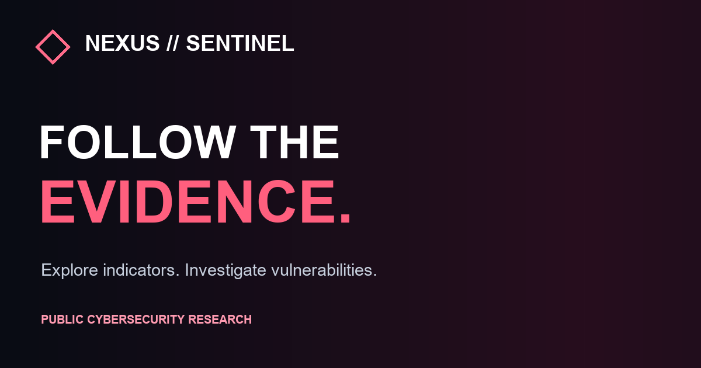

# NEXUS SENTINEL — Global Cyber Intelligence

**Explore the world's published cyber-threat indicators, investigate country-level evidence, and analyze known exploited vulnerabilities.**

**[Launch the live demo](https://zakadili.github.io/nexus-3d/)** · [Methodology](https://zakadili.github.io/nexus-3d/radar-methodology.html)



See [public-site improvements and verification](./AUDIT-FIXES.md).

**Data refreshes every six hours through GitHub Actions. This is not a real-time packet stream.**

A working multi-source cyber-intelligence command center: an interactive country-level threat-indicator globe, CISA exploited-CVE prioritization, reported EU sector impact, authorized active scanning, and an evidence-linked attack-path lab.

**Live project:** https://zakadili.github.io/nexus-3d/


## NEXUS LIVE (review-stage implementation)

The live layer adds filtered **RIPE RIS routing observations**, bounded evidence and an on-demand SSE connection to the existing SVG globe. It never turns routing changes into claimed attacks. Collection is off by default: the maintainer must record the permitted scope, accept the provider conditions and pass a capacity trial before activation. This branch's code does not mean the public deployment has been updated.

IODA and Certificate Transparency are excluded from active collection pending the [source gates](./radar-methodology.html#live-signals-methods). Cloudflare Radar and GRIP are also off. A source that fails or goes quiet is reported explicitly; no synthetic traffic fills the gap. Existing six-hour snapshots remain separate.

See [operation and release checks](./docs/LIVE-OPERATIONS.md), [security reporting](./SECURITY.md) and [responsible use](./docs/RESPONSIBLE-USE.md). Deployed AI agents remain inactive with a $0 spending authorization. Changes require human review and merge; deployment is a separate release step.

## Geographic integrity & country-level vulnerability intelligence

### Morocco geographical display and the southern territory
For the user-facing globe, NEXUS combines the Morocco geometry (ISO numeric 504) and the adjoining Western Sahara geometry (732) into a contiguous **Morocco-focused geographical outline** using TopoJSON merge at 1:110m resolution. Western Sahara's international political status is disputed. This is a **cartographic display choice**, not a determination of sovereignty. The country statistics labeled `MA` still represent only IP addresses assigned country code `MA` by the source IP database; `EH` allocations are **not silently added**.

The country camera is capped to keep the globe visible while zooming. Repeated clicks do not invoke `scrollIntoView` on the page; the selected ranking is scrolled only within its own panel.

### CVE Signals tab
Click a country → **CVE SIGNALS** to access two complementary sources:

1. **Shadowserver**'s public country-filtered exposed web-service vulnerability and honeypot exploitation views. NEXUS links out to the official provider rather than scraping data the provider restricts.
2. **Shodan InternetDB** on-demand, read-only enrichment of up to **10 source IP evidence samples** attributed to that country. It displays possible CVE identifiers, open ports and the number of sampled IPs referencing each CVE. Records may contain both verified and unverified vulnerabilities; this is NOT a country-wide prevalence ranking.

Results clearly report number of sampled IPs, successful lookups, missing observations and errors. A failed API request is never interpreted as absence of vulnerability. Some browsers or networks may restrict cross-origin access to InternetDB; when that happens, the provider links remain available.

Country IP indicator statistics, exploit-attempt origin, and vulnerable infrastructure locations are distinct kinds of evidence and must not be conflated.

## Investigation experience (v0.3)

The homepage is built for an actual on-screen investigation, not merely browsing threat lists:

- **Click a country:** smooth orthographic camera fly-to and country-focused HUD. Even unrepresented countries can be selected, with an honest "no observed coverage" message.
- **Country dossier:** total unique listed IPs, exact per-provider counts, rank, cross-feed overlap, sampled attributed IP evidence, and explanatory context. Evidence records can be investigated further using an on-demand **ipwho.is ASN/ISP/city lookup** and a SANS IPinfo link. Sample addresses are not a full inventory.
- **COUNTRY SEARCH:** press **Ctrl/⌘ + K** to jump to a country, or browse the complete ranked list. Mouse-wheel zoom and drag orbit are supported.
- **COMPARE:** pin one country, select another, then pin it to compare source-by-source listing volumes. Counts reflect feed coverage and should not be treated as comparative attack risk.
- **HISTORY:** the scheduled collector retains up to 28 recent country-count snapshots. A dossier sparkline appears when at least two comparable samples exist using the same set of successful feeds. Changes mean listing membership changes, not new compromises.
- **SHARE & EXPORT:** share deep links like `?country=MA&layer=ipsum`, export an evidence-labeled country brief, or **CAPTURE MAP** as a high-resolution PNG for X and presentations.
- **CINEMATIC TOUR:** a six-country, evidence-backed global camera tour for demonstrations, including stop and immersive-mode controls. The tour only visits countries present in the real data.

**Note:** country geolocation is approximate network allocation. It cannot identify where a specific attacker lives, prove that a device is vulnerable, or supply all malicious traffic observed in a country.

## Intelligence platform

### Multi-source country radar

GitHub Actions collects and deduplicates public IPv4 indicators from:

1. [blocklist.de](https://www.blocklist.de/en/export.html) — addresses reported during the last 48 hours.
2. [IPsum](https://github.com/stamparm/ipsum) — IP addresses appearing on at least three constituent lists.
3. [SANS ISC / DShield](https://isc.sans.edu/) — a sample of observed source addresses from reporting sensors.
4. [abuse.ch Feodo Tracker](https://feodotracker.abuse.ch/) — observed online botnet C2 infrastructure; its active feed may be empty.

Countries are inferred from the [DB-IP Lite](https://db-ip.com/) country range database (CC BY 4.0), distributed by [sapics](https://github.com/sapics/ip-location-db). The data pipeline uses IP-range binary search; it does **not** send tens of thousands of addresses to a per-IP lookup API.

**First successful collection, November 10, 2026:** 37,985 distinct listed IPv4 indicators, 37,983 country-matched, 159 countries; 25,874 blocklist.de records, 17,226 IPsum records, 300 DShield sample IPs, 1 online Feodo C2. These are source-list counts, **not global attacks**. Numbers change as feeds update; current counts are shown in the dashboard.

Use the map's **DATA LAYER** selector to compare source-specific coverage and select a country for counts from every provider. Source subtotals overlap, so do not sum them.

### Vulnerability priority engine

- [CISA Known Exploited Vulnerabilities](https://www.cisa.gov/known-exploited-vulnerabilities-catalog) full catalog.
- [FIRST EPSS](https://www.first.org/epss/) for selected recent or ransomware-linked candidates.
- [NIST NVD](https://nvd.nist.gov/) CVSS for a small number of top-ranked CVEs, respecting public rate limits.
- Transparent ordering heuristic: EPSS probability × 100 + 25 if CISA identifies known ransomware use + 10 if added in the last 30 days.

This is **not** a CVSS rating or exploit validation for a host. The user must interpret asset exposure and business impact separately.

### Industry impact research

The [ENISA Threat Landscape 2026](https://www.enisa.europa.eu/topics/cyber-threats/threat-landscape) provides historically observed incident shares for EU sectors over January–December 2025, not live worldwide sector counts. Top entries include public administration 31.8%, business services 8.5%, transport 8%, manufacturing 6.9%, and finance/banking 5.6%.

### Other modules

- [CVE Intel](./intel.html) — searchable CISA catalog with on-demand EPSS.
- [SENTINEL Attack Graph](./sentinel.html) — synthetic network/identity relationships and remediation simulation, running locally in the browser. The optional FastAPI backend remains available for local development.
- [Scoped Active Scanner](./scanner/) — real authorized TCP/HTTP/TLS checks with explicit CIDR allowlisting.

## How the live website works

A workflow at [`.github/workflows/intelligence.yml`](./.github/workflows/intelligence.yml) runs **every six hours** (also manually triggerable), runs [`sentinel/intelligence_pipeline.py`](./sentinel/intelligence_pipeline.py), and commits the JSON snapshot to [`data/overview.json`](./data/overview.json). The GitHub Pages homepage reads this committed JSON without needing API keys or a hosted backend.

The snapshot includes independent feed-health statuses. If a source fails, that source is explicitly marked unavailable; if no source succeeds, the snapshot is not overwritten. This is periodically updated intelligence, **not a live packet stream**.

## Run locally

```bash
git clone https://github.com/zakadili/nexus-3d.git
cd nexus-3d
python3 -m venv .venv
source .venv/bin/activate
pip install -r sentinel/requirements.txt
python3 -m uvicorn sentinel.main:app --host 127.0.0.1 --port 8765
```

Open http://127.0.0.1:8765/ for the global radar and http://127.0.0.1:8765/sentinel.html for the attack-path lab.

To regenerate the snapshot manually on a networked machine:

```bash
python3 sentinel/intelligence_pipeline.py
```

To run the tests:

```bash
PYTHONPATH=.:sentinel python3 -m unittest discover -s sentinel -p 'test_*.py' -v
node --check radar-plus.js
```

## Professional interpretation & ethics

A public IP on a suspicious-IP list is **not proof of malicious ownership**, a country code is **not attacker attribution**, and a CISA-listed CVE does **not prove any specific host is vulnerable**. Sensor-based rankings can be heavily biased by where sensors are deployed and what protocols they observe. Sectors use a dated ENISA EU study and are not combined with unrelated sources to create false global totals.

Read the full [methodology and licenses](./radar-methodology.html). The code is MIT licensed; third-party intelligence data retains its providers' own terms (including SANS attribution/noncommercial obligations and DB-IP attribution).

## Next milestones

- Longitudinal country trends and change detection across snapshots.
- Licensed country-level *vulnerable-device exposure* statistics to complement suspicious-IP infrastructure maps.
- Verified asset context (authorized scans, owned domains, confidence & provenance).
- Incident case builder and report generator.
- Advanced global map overlays and real-time event ingestion from an authorized honeypot fleet.

## Four supplementary intelligence sources

NEXUS adds four independent, source-attributed research features. They are collected into a compact **`data/extra.json`** file; the browser loads it separately from `data/overview.json`. No active scan is performed and no totals from unrelated datasets are added together.

| Source | What the dashboard shows | Access / collection |
|---|---|---|
| [URLhaus / abuse.ch](https://urlhaus.abuse.ch/api/) | Deduplicated malicious URL listings that have a **literal public IPv4 host** and can be mapped to an IP-country allocation; global URL tags | `ABUSECH_AUTH_KEY` GitHub Actions secret required; `recent.csv` export; 6-hour polling. Provider says exports regenerate every 5 minutes and must not be polled more frequently. |
| [ThreatFox / abuse.ch](https://threatfox.abuse.ch/api/) | Recent IOC listings with **literal public IPv4 endpoints**, top malware families and tags | Same `ABUSECH_AUTH_KEY` secret; authenticated `get_iocs` API, `days=7` (documented maximum), 6-hour polling. |
| [IPtoASN](https://iptoasn.com/) | Top networks (ASNs) announcing already-listed source IPs, per country and top 10 globally | Downloadable `ip2asn-v4.tsv.gz` range database; no API key and no per-IP lookups; **PDDL v1.0** public-domain dedication. |
| [IODA / Georgia Tech](https://ioda.inetintel.cc.gatech.edu/) | Recent reported country outage events, signal source and observed start/end timestamps | Public v2 `outages/events` API; no API key documented; one bounded request every six hours. No numeric rate limit is published on the endpoint reference consulted. |

**Set up abuse.ch:** create a free authentication key via the [abuse.ch authentication portal](https://auth.abuse.ch/). Store it under **GitHub repository Settings → Secrets and variables → Actions → New repository secret**, named `ABUSECH_AUTH_KEY`. Do not add a key to client-side JavaScript or commit it to the repository. Missing or invalid keys are shown as **unavailable**, not as zero observations. abuse.ch Community APIs are governed by fair-use/terms; commercial usage may require a paid product. <https://www.spamhaus.com/faqs/abuse-ch/>

### Interpretation boundaries

- **Listed URLs/IOCs hosted in this country, not attacker location.** Unresolvable domain-only URLs and non-IP IOCs are not assigned to countries; their global families/tags may still be counted.
- **Top ASNs are network allocations, not malicious providers.** A hosting company appearing on a list does not make that company responsible for the listed activity.
- **Outages have many causes and are not necessarily related to cyber activity.** IODA provides connectivity evidence, not proof of a cyberattack.
- **Feed availability is independent.** Each source gets a success/unavailable status and a short provenance note. The 28-snapshot timeline indicates success/failure/missing only when those states were recorded.

The dashboard loads the **most recently published six-hour collection snapshot**, never a live packet stream. If the main snapshot fails in the browser and a previous valid one was cached locally, the page labels it as the last good snapshot rather than presenting it as fresh.

## Limitations

- **Not live:** GitHub Actions attempts refreshes every six hours; individual feeds have their own reporting delays and outages.
- **Not attack counts:** country totals are distinct IPv4 addresses appearing in participating public indicator lists, not verified incidents, infected machines, attackers or victims.
- **Geolocation is approximate:** country codes describe network IP allocation, not attacker identity or location.
- **Not national CVE prevalence:** Shodan InternetDB checks a small, nonrandom sample of listed IPs. A possible CVE match is not proof of exploitability; no match is not proof of safety.
- **Comparable trends only:** rises and falls compare snapshots with the same successful provider set. Changes are **changes in list membership, not new compromises**.
- **Incomplete geographic coverage:** a missing country or feed entry does not imply an absence of security threats.
- **Data-source licensing:** third-party datasets retain their own licensing and attribution requirements.
- **Deployment differences:** the GitHub Pages interface uses static snapshots; local FastAPI modules require a separately running backend. Third-party APIs may be unavailable or blocked by CORS.

## Responsible use & disclaimer

NEXUS SENTINEL is provided for educational, research, and authorized security-testing purposes only.

The active scanner must only be used against systems you own or have explicit written permission to test. Unauthorized scanning may be illegal in your jurisdiction.

The author is not responsible for any misuse of this software or for any damage, loss, or legal consequences resulting from its use. You are solely responsible for how you use it and for complying with applicable laws.

Threat-intelligence data is provided for informational purposes. IP and country listings do not prove malicious ownership or attacker attribution.

## Public website publication

Pages uses the `Publish NEXUS website` workflow. It validates and packages public files on code pushes and after a successful intelligence collection, so bot-published data reaches the live site. Keep GitHub Pages Source set to **GitHub Actions**. See [maintenance and verification](./AUDIT-FIXES.md).

