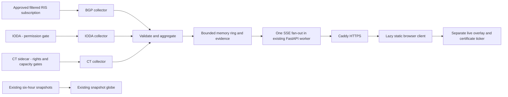

# NEXUS LIVE — proposed design and approval gate

Status: **DESIGN ONLY — awaiting human approval.** No live collector, API or globe changes are authorized by this document alone. One human-reviewed pull request per work package; a human merges each PR.

Source checks: 11 November 2026; design prepared for review on 12 November 2026. Repository baseline: `e830e07d1f931f76c674ea0615bc5d677a77ae40`.

## 1. Product contract

NEXUS LIVE adds independent, attributable Internet signals to the existing map. It does not observe every attack, infer attacker locations, scan infrastructure, or animate invented traffic.

Required visible explanation:

> No public source gives a per-attack feed of the whole Internet. NEXUS shows several independent Internet signals. Hosting country, ASN registration country and routing activity are not attacker attribution.

Every displayed pulse must originate from a retained, validated source event or a documented aggregate. No source event means no pulse. Errors and missing data never become zero activity. Snapshot counts and live counts never share a total.

## 2. Existing implementation verified

| Existing component | Reuse and boundary |
|---|---|
| `.github/workflows/intelligence.yml`, `sentinel/intelligence_pipeline.py`, `data/overview.json`, `data/extra.json` | Scheduled snapshot collection at `17 */6 * * *`. A schedule is not a guarantee of successful publication; display the actual collection timestamp and stale state. |
| `streaming/app.py`, `operations.py`, `public_feeds.py`, `schema.sql` | FastAPI ingestion, PostgreSQL retention/replay, source health, reference data, public-list snapshots and WebSocket delivery already exist. Extend their lifecycle and safeguards; do not replace them. |
| `streaming/Dockerfile`, `docker-compose.yml`, `Caddyfile`, systemd units | One API worker; API runs as UID 65532, read-only, with dropped capabilities. API and database each have a 256 MiB ceiling. API binds to host loopback behind Caddy. Preserve these boundaries. |
| `live-loader.js`, `stream-adapter.js`, `stream-config.js` | Lazy browser connection and visibility handling already exist. Current events use `seq`, `feed_source`, `source_ts` and `received_at`; they are not the new normalized contract. Keep the legacy channel compatible. |
| `radar-plus.js`, `radar-extras.js` | The current globe is D3/SVG. Its country selection and snapshot rendering are the extension points. It does not currently plot the requested live signals. |

The existing IODA collector reads `/v2/outages/alerts` every 180 seconds. The proposed outage layer uses processed **events**, with a five-minute polling policy, only after its data-use gate clears. Existing durable feed storage is separate from the new aggregate-only memory buffer. Existing restricted-feed access does not authorize public republication.

`scanner/` is outside every work package. The public file-import controls removed by the owner must stay absent.

## 3. Source register and activation decisions

### RIPE RIS Live — conditional first live layer

The [current manual](https://ris-live.ripe.net/manual/) documents anonymous WebSocket subscriptions, filters, unique message IDs and RRC receive timestamps. Use a descriptive client identifier, one server connection, acknowledgement and server-side filtering. No numerical quota was found; slow consumers can be disconnected. Never open an upstream connection per visitor.

The [RIS-specific commercial-use conditions](https://www.ripe.net/analyse/internet-measurements/routing-information-service-ris/commercial-use/) grant conditional, revocable permission for derivatives. They require the RIPE NCC logo, a RIS link and the provider's complete prescribed description. The [general terms](https://www.ripe.net/about-us/legal/terms-of-service/) contain redistribution restrictions and third-party-rights provisions. This is **not** an unrestricted blanket data license. Before activation, the owner must review those conditions and the implementation must include all required attribution. The separate RIPE Data Repository agreement is not a substitute RIS license.

Begin with an explicitly named collector and an operator-approved prefix/path filter set. No unfiltered production firehose. The later capacity test determines a safe scope; its exact scope must appear in health/evidence. A collector's observation of routes is not a count of unique global routing incidents.

Compile a compact ASN lookup from the publisher's [ipverse/as-metadata JSON](https://github.com/ipverse/as-metadata), under its published [CC0 license](https://github.com/ipverse/as-metadata/blob/master/LICENSE). Use only authoritative country provenance, retain the dataset commit/hash/date and preserve unknowns. Label the result **ASN registration country**, never physical or attacker location. Operator-base-country datasets are not interchangeable with registration metadata.

Aggregate announcements by scalar origin ASN and registration country in short windows. Count messages and prefix announcements separately. An AS_SET or absent/unknown origin remains unlocated. Withdrawals lack a reliable origin path: V1 shows their unlocated counts; it must not assign a country from the peer or collector. Origin-change candidates require a bounded, same-peer/prefix observation cache; incomplete state suppresses the candidate. Rate spikes require a warmed rolling baseline. Neither candidate is called a hijack or attack.

### IODA — public republication disabled pending permission

The institution's [HTTP API documentation](https://api.ioda.inetintel.cc.gatech.edu/v2/) documents processed `/v2/outages/events`, alerts, entity metadata and geographic topology. Its processed events are preferable to noisy raw alert transitions. Bounded, authentication-free reads were verified. No numeric API quota or API-wide 31-day restriction was verified. Do not repeat that third-party claim.

Live API responses carry a Georgia Tech Research Corporation copyright notice, including “All Rights Reserved.” No suitable API-data republication grant was established. **Attribution alone is not permission.** Keep the proposed public layer disabled until a primary grant or written permission is recorded. If permission cannot be established, omit the collector rather than silently proxy its data.

If cleared, poll every 300 seconds with bounded pagination, caching, jitter and backoff; these are NEXUS policies, not provider guarantees. Preserve reported start/end, entity and source severity. Event-window extension can include older ongoing outages, so a returned result is not necessarily a new outage. Required UI attribution: Georgia Tech IODA, linked to the source. Required explanation: **Outages have many causes and are not necessarily cyber activity.**

### Certificate Transparency — disabled pending rights and capacity checks

[certstream-server-go v1.10.1](https://github.com/d-Rickyy-b/certstream-server-go/releases/tag/v1.10.1) has an [MIT software license](https://github.com/d-Rickyy-b/certstream-server-go/blob/v1.10.1/LICENSE). This does not establish permission to redistribute every monitored log's contents. Record selected log operators and their current data-use conditions before activation; unresolved logs are excluded.

Its [message model](https://github.com/d-Rickyy-b/certstream-server-go/blob/v1.10.1/internal/models/certstream.go) shows that `/domains-only` discards provenance needed for traceability. Proposed deviation requiring approval: consume the **lite** endpoint privately, count/match locally, and immediately discard unnecessary subjects, chains and domain strings. Publish aggregate counts and keyword-candidate counts, not a raw domain feed. This remains a certificate ticker, never a geographic layer. Do no DNS resolution, probing or fetching of observed domains.

Use **CT observations/s**, not worldwide certificate issuance: multiple logs, precertificates and final certificates can duplicate observations. Keyword matches are candidates, not confirmed phishing. The [parser](https://github.com/d-Rickyy-b/certstream-server-go/blob/v1.10.1/internal/certificatetransparency/ct-parser.go) distinguishes log timestamps from local processing time; certificate validity dates are neither. Tiled logs can have an empty `cert_link`: retain log identity/type and entry index/ranges, and never invent an entry permalink.

The upstream [README](https://github.com/d-Rickyy-b/certstream-server-go/blob/v1.10.1/README.md) contains a historical bandwidth/resource benchmark, not a measurement of this server. Domains-only output does not remove upstream ingestion cost. The current small shared host has no verified CT capacity. A separate CT sidecar would also be an explicit exception to the one-service target; do not silently add it. Activation requires a bounded trial or separately approved capacity.

If approved, pin an image digest, run UID 10001, bind only on the internal Docker network and mount the [verified entrypoint config path](https://github.com/d-Rickyy-b/certstream-server-go/blob/v1.10.1/docker/Dockerfile.goreleaser), `/app/config/config.yaml`. Set `general.disable_default_logs: true`; use only reviewed `additional_logs` / `additional_tiled_logs`, so discovery cannot silently add unreviewed logs. Explicitly disable recovery/backfill, Kafka/NSQ forwarding and public metrics/ports; sample defaults are inconsistent. Review [sample](https://github.com/d-Rickyy-b/certstream-server-go/blob/v1.10.1/config.sample.yaml) and [Docker](https://github.com/d-Rickyy-b/certstream-server-go/blob/v1.10.1/config.docker.yaml) configurations rather than copying them blindly.

Before a trial, record an owner-approved bandwidth allowance and explicit CPU/RAM/network ceilings. Proposed trial policy: at least 30 minutes on the intended log allowlist, reporting peak RSS, CPU, ingress, queue losses and source gaps. Abort on a limit breach, OOM/restart or regression in existing NEXUS health; keep the source disabled after any failure. A successful trial does not prove future full-firehose capacity. These are acceptance policies, not measured results.

### Optional context and existing snapshots

[Cloudflare Radar](https://developers.cloudflare.com/radar/) requires a server-side Radar Read token and licenses its API data under CC BY-NC 4.0. Leave it off unless the owner's use satisfies that license or separate permission is established. It is aggregated Cloudflare context, not per-event global telemetry. Global API limits are not a Radar-specific allowance; honor current response rate headers and 429s. [Access](https://developers.cloudflare.com/radar/get-started/first-request/), [limits](https://developers.cloudflare.com/fundamentals/api/reference/limits/), [aggregation](https://developers.cloudflare.com/radar/concepts/aggregation-intervals/).

GRIP is excluded from V1: a public [legacy API specification](https://github.com/InetIntel/grip-api-legacy/blob/master/api-spec.md) is not verified current redistribution permission.

Keep blocklist.de, IPsum, DShield, Feodo, KEV and EPSS as distinct snapshot/reference data. Label the site collection **scheduled every six hours**, show actual timestamps and distinguish providers' own publication cadence. A vulnerability catalog or probability estimate is not a live observation.

## 4. Additive architecture

Add collector modules and a live-signal subsystem under `streaming/`; join the existing FastAPI lifespan. Use one API worker. The new subsystem does not write raw observations into PostgreSQL. Extend the current deployment, health reporting and Caddy allowlist; retain compatible legacy WebSocket/public-list routes.

Proposed public routes:

- `GET /api/live/events`: the single SSE fan-out, including source-health and explicit replay-gap frames.
- `GET /api/live/evidence/{id}`: bounded aggregate provenance, with expiry.
- Existing `GET /api/health`: retain existing fields and add live-source status, last message/event/receive/check times, current scope, completeness and drop counters.

CORS is exactly `https://zakadili.github.io`, without credentials or wildcards. Browser origins cannot be restricted to a URL path. Origin checking is not authentication: enforce actual connection, byte and rate limits too. Caddy exposes only the selected public routes; no admin, database or CT port becomes public. SSE responses disable caching, buffering and compression that could delay delivery; use immediate proxy flushing. Trust client-address information only from the configured Caddy peer, which must overwrite client-supplied forwarding headers.

### Normalized event contract

| Field | Contract |
|---|---|
| `id` | Stable bounded identifier for one source event or closed aggregate; deduplicate before rendering. |
| `source`, `type` | Versioned allowlists, including `ris_live`, `ioda`, `certstream`. |
| `ts_observed` | UTC ISO 8601 source event time; never silently substitute collection time. For a closed aggregate, use its latest contributing source timestamp and retain the full source-time range in evidence. |
| `ts_received` | UTC ISO 8601 server receipt time. |
| `country` | Optional validated ISO country code; absent means unlocated, not a guessed coordinate. |
| `asn` | Optional validated ASN, without an invented country fallback. |
| `value` | Optional finite number with type-specific units. Counts, severity and probabilities are not interchangeable. |
| `label` | Bounded plain text. |
| `evidence_url` | HTTPS URL generated from an approved source/local evidence record, not an arbitrary source-supplied link. |
| `attribution` | Approved source credit; full license notices remain on Methods. |
| `confidence` | `observed`, `derived` or `candidate`; these are evidence classes, not numerical certainty. An aggregate is a derivation, not an attack verdict. |

Missing mandatory timestamps or invalid schema means reject the record and report rejected/incomplete coverage. Never fabricate fields to satisfy validation.

SSE `event: observation` carries this normalized contract. `event: health` and `event: gap` are separate versioned control objects with `schema`, `server_time` and their status/reason fields; neither invents a source `ts_observed`. Keepalives are SSE comments, not observations or counter increments. Collector PRs use this approved contract and a test-double evidence sink until the later API PR integrates it; no collector deploys independently before integration passes.

### Evidence and memory limits

RIS Live has no documented per-message permalink. A homepage link is not proof of an individual pulse. Each aggregate therefore links to a NEXUS evidence manifest containing its window, units, source timestamps, collector/subscription, opaque input digests, mapping version, sample/count coverage and gaps. Raw RIS IDs can encode peer IPs: never publish those IDs. Use per-process keyed digests instead; discard raw IDs after bounded deduplication/aggregation. This documents NEXUS processing, not independently replayable provider proof. No raw peer IPs, domains, certificates or personal fields are published. Full raw-record redistribution needs separate rights.

Evidence is deliberately short-lived: show its expiry in the details panel and return 410 after eviction. Coordinate event/evidence eviction; never replay an actionable pulse whose evidence is already absent. There is no claim of permanent forensic replay. Reconnects outside the ring or across a restart explicitly report a gap. Expired evidence never resolves to a different event. Permanent aggregate history is a later, separate decision.

Proposed initial limits below are **engineering starting points**, not provider quotas or measured capacity:

| Resource | Initial bound / failure behavior |
|---|---|
| Upstream frame | 64 KiB; decompressed HTTP body 2 MiB; reject larger data. Normalized records at most 2 KiB. Bound depth, arrays and field lengths before costly processing. |
| Intake | Bounded queues; configurable byte and message ceilings before expensive parsing. Reduce subscriptions or disconnect/back off when capacity is exceeded. |
| BGP windows | Start at 10 seconds; collector/filter scope and count semantics visible. Rolling baseline has a warm-up state; no cold-start anomaly claims. |
| Public emission | Global 64 normalized events/s; BGP 50/s, IODA 10/s and CT 1/s, with coalescing and explicit losses. Frames at most 16 KiB; do not forward raw feed messages. |
| Memory | Ring at most 2,000 records, 30 minutes and 8 MiB, whichever is reached first. Evidence has a separate 8 MiB bound; route-origin cache at most 10,000 keys with expiry. |
| Aggregate/cache maps | At most 512 active window buckets; 512 baseline series with 60 windows each. Origin-cache keys are opaque 32-byte digests; values have fixed-size ASN/time fields. Overflow invalidates affected baseline comparisons, not an apparent activity spike. |
| Clients | 8 global and 2 per client address; each queue at most 64 frames or 128 KiB, whichever first. Disconnect slow clients; report a gap on recovery. |
| Request admission | Per-address 5 SSE connection attempts/minute, burst 2; evidence 30 requests/minute, burst 10, response at most 16 KiB. Use 429/503 with Retry-After, not an unbounded wait queue. Address-rate keys stay only in expiring memory. |
| IODA | At most one in-flight poll; 300-second interval; bounded pages, overlap/checkpoint deduplication and explicit truncation status. |
| CT | One aggregate ticker update/s; bounded keyword set and matching work. No domain resolution. |

Thirty minutes is a maximum record age, not guaranteed replay duration: 2,000 records at 64/s cover only about 31 seconds, and byte limits may shorten it further. Expose the actual oldest retained cursor/time and test eviction at the configured ceiling.

Backoff uses jitter and a ceiling; respect provider retry instructions. No catch-up firehose after downtime. New-layer application and edge logs omit source payloads, tokens, raw visitor/peer IPs and observed domains; use aggregate counters and ephemeral rate-limit keys. Treat quiet/healthy-empty, stale, unavailable, disabled and license-blocked as different states; an error is never a successful empty response. Capacity drops must not create successful zero counts or baseline/anomaly spikes.

## 5. Frontend behavior and measurement

Extend `radar-plus.js` with a small live-overlay interface, not a replacement globe. Preserve snapshot country selection, dossiers and navigation. SVG pulses share the existing projection; cap simultaneous pulses at 30 and pending visual entries at 100. Coalesce excess visuals and report that display sampling separately from source coverage. No attacker/victim arcs.

The Live group has separate routing, outage and certificate controls. Disabled sources show their reason. Routing positions mean registration-country centroids. Outages highlight the provider's affected geographic entity, not an invented precise coordinate. CT has no country or map geometry.

Connect only when Live is open, visible, resumed and an eligible source is enabled. Disconnect and stop added animation work when hidden/paused/closed. Reduced motion uses static highlights/text updates. Replayed old records do not create fresh-looking pulses. Every item is keyboard-selectable and exposes source, times, units, confidence, evidence and expiry. Display last-event times and clearly defined events/min per source; never combine them with snapshot totals.

All external strings use `textContent`/DOM construction. Validate URLs and limits at both boundaries. Existing constant HTML templates are not a license to interpolate feed data into HTML. Add no new per-frame work except drawing queued live visuals. The current SVG globe has no renderer pixel ratio; if a canvas overlay is introduced, cap its device pixel ratio at 2.

Targets are 60 fps on the tested laptop and 30 fps on a named mid-range phone, not current measured results. Frontend PR must report before/after devices, browser, viewport, data rate, frame-time percentiles, dropped frames, memory, console/network errors and accessibility checks. Desktop viewport emulation alone does not verify a real phone's performance. Local replay fixtures must be unmistakably test-only and never reach production.

## 6. Specialist allocation and PR gates

CEO coordinates existing specialists, reports actual progress and blockers, and cannot waive source rights, budgets, human review or security findings. Discord displays substantive task comments, handoffs and review results; it is not fabricated conversation or private model reasoning.

| Order / owner | One PR's scope and acceptance | Gate |
|---|---|---|
| 1 — Architect/Lead | This design: existing-code inventory, contract, source register, limits and unresolved decisions. | Human approves the design before implementation. |
| 2 — Collector-BGP | Filtered RIS client, versioned licensed mapping, bounded aggregation/cache/baseline, evidence and reconnect/gap behavior. Tests cover scalar/ambiguous origins, unlocated withdrawals, duplicates, overflow and recorded/redacted permitted samples. | Design + RIS conditions + mapping provenance + capacity trial. |
| 3 — Collector-IODA | Processed-event polling, cache/checkpoints, deduplication, entity normalization and attribution; tests distinguish old ongoing events, empty results and failures. | No collection/republication PR presented as complete without data rights. If dropped, document exclusion. |
| 4 — Collector-CT | Private pinned unprivileged sidecar, no backfill, provenance-preserving intake, bounded counts/keyword candidates and no DNS/probing. | Selected-log rights + measured capacity + approved sidecar exception. Otherwise remain excluded. |
| 5 — Normalizer/API | Contract validation, aggregate/evidence ring, SSE/replay gaps, per-source health, bounds, exact CORS, Caddy and deployment changes. Tests include malformed data, slow clients, restart and source outages. | Cleared source modules; retain existing integration tests. |
| 6 — Frontend | Separate live controls/legends, bounded real-event visuals, ticker, details, pause/meters, keyboard/reduced-motion and measured performance. | Stable API; no simulated production events. |
| 7 — QA/Security | Independent severity-ranked review of every preceding PR: XSS, URL validation, exhaustion, leakage, licensing and regressions. | Block merge of affected work until high/critical findings are fixed. |
| 8 — Documentation | README, methodology, About, CHANGELOG, SECURITY and Responsible Use; full credits, definitions, exclusions and operating instructions. | Describes verified final behavior and actual source permissions. |

Each PR states tested behavior, results and what could not be verified. Keep the sequence; do not open empty collector PRs to imply blocked sources are finished. Recorded fixtures must be licensed, minimized and clearly labeled; uncertain raw-data rights block committing those fixtures.

Agents have no root access, SSH keys or personal accounts. Current authorization permits **no paid agent execution**: scheduled, on-demand and runtime execution remain disabled, without AI service credentials. Before any later activation, obtain an explicit authorized ceiling and configure dedicated service identities/secrets, per-agent token/cost ceilings and stop-on-budget/loop controls. A budget value of zero is not assumed to be an enforcement mechanism: paused execution and absent credentials must prevent unauthorized spending. Use isolated task worktrees and a real global runtime lock on the small host; a per-agent concurrency limit alone is insufficient. Agents may propose branches/PRs, never push or merge main. Main protection and a human-only merge path must be verified before granting a GitHub service identity write access.

## 7. Approval decisions and definition of done

Human approval must explicitly accept: (a) filtered RIS coverage and its attribution conditions, (b) registration-country semantics and unlocated withdrawals, (c) bounded/expiring evidence rather than permanent raw replay, (d) IODA's permission gate, (e) CT's lite-intake, aggregate-only output, rights/capacity/sidecar gates, and (f) optional sources remaining off when conditions are unresolved.

Approval of the architecture does not clear an unresolved license or authorize higher spending, hardware purchases, scanning, production deployment or automated merging.

Release only when each displayed live item has real provenance, stale/unavailable sources never generate filler, the globe and existing research functions pass measured regression checks, tests pass and CI is green. A human reviews and merges each PR. The final report lists one line per actual PR, source permissions, real performance measurements, tests, unverified items and every remaining **needs license check**.

Current verification: repository/design review and primary-source checks only. No new source collector has been deployed; no live-layer performance, source completeness, recovery behavior or production acceptance result is claimed.
